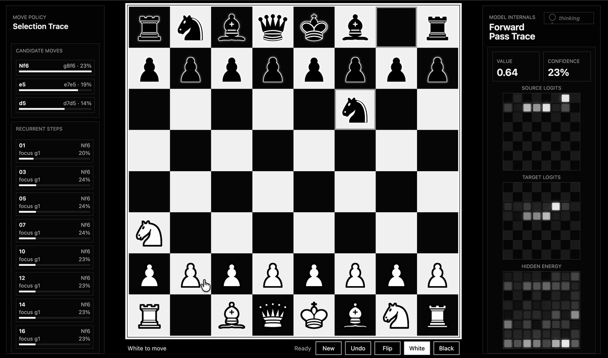
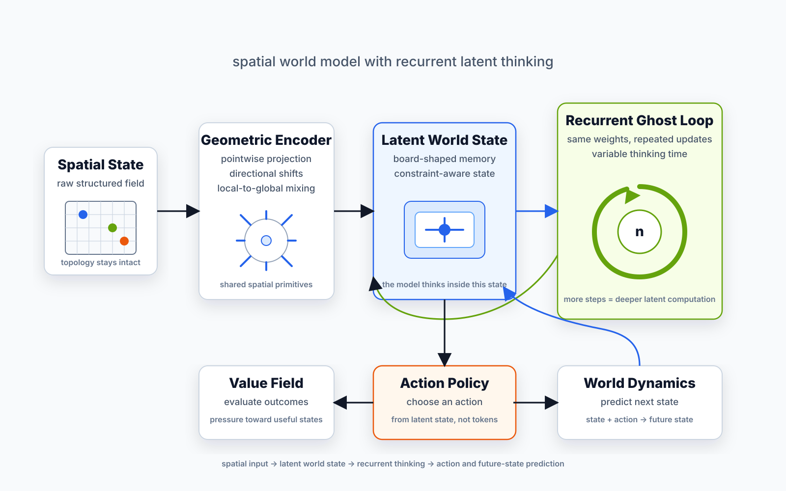

# VOID

**A spatial world-model architecture with shared recurrent computation.**

VOID combines geometric shifts, learned tensor contractions, and a recurrent **Ghost loop** to process structured spatial states. It keeps a spatial latent map, refines that map over multiple thinking steps, and reads out actions, outcomes, and action-conditioned predictions of the next state.

Chess is one instantiation of VOID: a compact environment for studying spatial computation, latent recurrence, and learned dynamics. This repository contains the chess architecture, curriculum trainer, a pretrained checkpoint, and a playable demo.

**[Play chess.eigenesis.org](https://chess.eigenesis.org/)**

The included [`chess.pt`](chess.pt) is a stripped **Phase 4, pre-RL checkpoint**: **11,045,201 parameters**, approximately **42 MiB**, with **16 recurrent thinking steps**. The hosted demo may use a later checkpoint.

With the same frozen **Phase 4.5** checkpoint, Imagine increased score from **21.81% to 44.19%** across a 1,600-game Stockfish benchmark with paired openings and equal game clocks. See [the benchmark results](#stockfish-benchmark).



## Spatial Computation

The architectural premise is that spatial relationships should be explicit in the computation. The chess model receives a canonical `14 x 8 x 8` tensor: twelve piece planes, a turn plane, and a castling-rights plane. Black-to-move positions are mirrored by rank and represented relative to the side to move. It consumes structured board data directly, without text or image-patch tokenization; the hidden representation is a continuous spatial field.

Each geometric block:

1. Normalizes the latent features at each square.
2. Forms nine views: the center and eight neighboring directions.
3. Applies a separate learned channel projection to each view.
4. Concatenates, transforms, and projects the results back into the latent map through a residual update.

The encoder uses these operations to build a board-shaped representation. Stacking blocks and repeating the Ghost loop lets information propagate across longer spatial distances. The geometry supplies a neighborhood structure; useful chess relationships still have to be learned.

The implementation uses shifts, linear projections, and `einsum`, with no attention layers. These local operations are related to convolutional spatial mixing even though they are written without `Conv2d`. For fixed channel widths and a fixed number of directions, a block's work scales linearly with the number of spatial cells. Recurrence adds computation in proportion to the number of thinking steps.

Boundary behavior is checkpoint-dependent. Original checkpoints use wrapping `torch.roll` shifts; the Phase 4.5 repair gradually blends in zero-padded, non-wrapping shifts. A partial blend still permits some wraparound.

## The Recurrent Ghost Loop

**The Ghost loop reuses one learned block across depth.** Each iteration receives the evolving latent state together with the original encoded input:

```python
x_init = encode_board(board)
x = x_init
gate = sigmoid(ghost_gate_logit)

for _ in range(n_think):
    candidate = ghost(x + x_init)
    x = x + gate * (candidate - x)

from_logits, to_logits, value = heads_from_state(x)
```

The `ghost` block has the same parameters at every iteration. Increasing `n_think` increases effective computational depth without increasing parameter count. The input anchor supplies the original board representation on every iteration, while the learned gate controls how strongly each update changes the state.

This is recurrence **within a decision**. The chess implementation initializes a new latent state for each input board; it does not carry a persistent hidden state from one real game move to the next. Normal inference already includes the Ghost loop. A single call to the model can execute sixteen recurrent updates.

Training samples different depths, such as `2, 4, 6, 8, 12, 16`, and applies auxiliary policy/value losses to selected intermediate states. This trains useful predictions at multiple compute budgets. Later sharpening concentrates training at the intended deployment depth. More steps provide more computation, but improvement must be measured: additional recurrence can plateau or degrade predictions.



## Prediction Heads

The chess instantiation shares its encoder and recurrent block across several outputs:

| Head | Output and purpose |
|---|---|
| Policy | Source logits `[B, 64]` and source-conditioned destination logits `[B, 64, 64]` for move selection. |
| Value | A bounded outcome estimate in `[-1, 1]` from the side-to-move perspective. |
| World model | Given a board and candidate move, predicts the next canonical board tensor `[B, 14, 8, 8]`. |
| Legality | Auxiliary logits over source/destination pairs. Exact legal masking remains external. |
| Terminal distance | Estimates normalized distance to game termination; also supplies a learned policy-pressure pathway alongside value. |

The world-model path injects source and destination embeddings into the encoded spatial map, applies recurrent updates, and predicts the successor board. It is supervised on actual transitions. **Latent computation and explicit next-state prediction are complementary parts of this architecture:** its internal computation is continuous, while its transition target is an observable board representation.

The Ghost loop refines a representation of the current position. A world-model rollout instead predicts a successor position and evaluates it, potentially repeating that process for further actions. One recurrent step is therefore not one future chess move.

## Direct Play and Imagine Mode

**Direct mode** reads the policy after recurrent refinement and selects among moves permitted by `python-chess`. The learned legality head supplements training; it does not replace the rules engine.

**Imagine mode** adds fixed-width, model-guided lookahead: candidate move, legal opponent replies, and a follow-up. The repaired controller grounds every prediction in a valid rules state instead of repeatedly feeding potentially invalid predicted boards back into the transition head. It checks immediate mates and mating replies outside the policy shortlist. This requires additional model calls beyond direct inference.

The benchmarked controller uses **six root candidates, two policy-ranked opponent replies, and three plies**, with sixteen recurrent steps for policy/value evaluation. Terminal and tactical safeguards can inspect moves outside those shortlists. It evaluates both exact legal states and one-step world-model predictions; disagreement limits the influence of predicted-state values when identifying the worst searched reply.

The validated preference controller then calibrates the selected exact-state value into win/draw/loss probabilities. Its score combines a policy-prior penalty with expected negative log preference over outcomes. A minimum policy probability and an override margin constrain changes to the direct choice; mate, tactical, and conversion safeguards take precedence. This calibration is bound to the checkpoint hash. The separate experimental energy reranker and probabilistic EFE variants were disabled for the benchmark.

This is **active-inference-inspired control**: explicit outcome preferences guide action selection through predicted consequences. It uses fixed-width lookahead, **without MCTS**. Exact rules constrain the lookahead; the network supplies policy, value, and action-conditioned predictions. Stockfish supplied offline calibration labels and benchmark opponents; no Stockfish search runs inside Imagine's move selection. The implemented objective does not establish formal expected free energy or the broader Free Energy Principle.

## Stockfish Benchmark

Completed October 11, 2026, with one frozen Phase 4.5 checkpoint and no training during evaluation. Both modes used `n_think=16`, the same 100 held-out opening families, reversed colors, and **120 seconds + 1 second per move**. Each mode played 200 games against each Stockfish 19 `UCI_Elo` setting: **1,600 games total**. The machine was an Apple M2 with four simultaneous games and MPS inference.

| Stockfish UCI_Elo setting | Direct score | Imagine score |
|---|---:|---:|
| 1500 | 39.75% | **74.25%** |
| 1800 | 18.00% | **37.50%** |
| 2000 | 20.00% | **36.00%** |
| 2200 | 9.50% | **29.00%** |
| Overall, 800 games per mode | 21.81% | **44.19%** |

Score counts a win as 1 and a draw as 0.5. Imagine improved score at every setting. The paired improvement across the pool was **22.38 percentage points**, with a **95% opening-family bootstrap interval of 18.62 to 26.38 points**. All games completed, with no reference or infrastructure failures. One Imagine time forfeit remained in the results.

The conditional rating fit was **1556 for Direct** (97.5% interval: 1516-1594) and **1823 for Imagine** (1788-1860). These are performance equivalents relative to Stockfish's configured labels under an assumed logistic score curve. Both observed score curves fit that assumption poorly, so the per-opponent scores are stronger evidence than a single rating. **This does not certify human/online Elo or establish 2000+ strength.**

The result demonstrates improvement from the complete Imagine controller at equal game clocks, with additional computation. It does not isolate the contributions of world-model predictions, calibrated values, tactical safeguards, or lookahead. Mean model decision latency was approximately 0.15 seconds for Direct and 1.37-1.42 seconds for Imagine under this four-worker setup; hosting performance can differ.

[Full results, protocol, and limitations](reports/stockfish_benchmark_20261010.md).

## Curriculum and Status

| Phase | Training focus |
|---|---|
| 0 | Tactical supervision from Lichess puzzles. |
| 1 | Full human games rated at least 1800 Elo, with puzzle and lower-rated replay. |
| 2 | Opening positions from games rated at least 2000 Elo. |
| 3 | Middlegame positions from games rated at least 2200 Elo. |
| 4 | Endgames with at most ten pieces, from games rated at least 2000 Elo. |
| 4.5 | Supervised repair on full games rated at least 2000 Elo, adding legality supervision and gradual boundary repair. |
| 5 | Experimental world-model expert iteration, with policy/value anchors and replay. |

Supervised phases combine move imitation and outcome prediction with available world-model, distance, legality, and intermediate-depth targets. Replay mixes earlier data into later phases to limit forgetting. Dataset rating filters describe the training games, not the model's measured Elo.

The current Phase 5 implementation provides `audit`, `gpu_improve`, and `gauntlet` stages. Its improvement stage trains against targets derived from world-model candidate evaluation with KL and behavior-cloning anchors. Outcome-based self-play RL remains a research direction; the included checkpoint is pre-RL.

## Evidence and Open Questions

An earlier local calibration experiment over **2,000 positions**, using grouped nested five-fold cross-validation, reported:

| Metric | Direct policy | Calibrated Imagine selector |
|---|---:|---:|
| Mean clipped Stockfish candidate loss | 53.92 cp | 52.70 cp |
| Blunder rate | 13.80% | 13.45% |

The reported 95% bootstrap interval for the reduction in clipped candidate loss was **[0.43, 2.11] cp**. That earlier selector changed **0.75%** of positions; this static result is separate from the controller and game evidence above. Historical deterministic-start head-to-head wins do not establish an Elo increase across varied openings.

A later probabilistic-controller experiment tested single-calibrator and ensemble variants (P1/P2) on 800 held-out positions from 80 opening families. Both changed only seven moves relative to the frozen baseline and failed their preregistered improvement gates. They remain disabled. Greater resemblance to an expected-free-energy objective has not yet demonstrated stronger play here.

Learned transition errors also accumulate during rollout. A local Phase 4.5 fidelity evaluation on 400 starting positions reported piece F1 falling from approximately **0.77 at one step to 0.38 at three steps**, with no exact full-board matches. The world model's uncertainty and fidelity therefore matter when deciding whether its predictions should override the policy.

The main research questions are whether additional recurrent computation improves held-out decisions, whether geometric routing contributes beyond simpler spatial baselines, and whether world-model guidance improves play under matched compute and diverse openings. Generalization to other spatial domains requires separate experiments.

## Use the Architecture

[`void.py`](void.py) contains the model, board encoding, and move indexing. [`train.py`](train.py) contains curriculum configuration, cache construction, checkpoint handling, and evaluation.

```bash
python -m pip install torch numpy python-chess datasets zstandard
```

For example, train or resume the foundation phase with a disk-backed cache:

```bash
python train.py \
  --phase 1 \
  --stop-after-phase 1 \
  --all-steps \
  --use-gm-cache \
  --gm-cache-samples 10000000 \
  --phase12-batch 768 \
  --num-workers 4
```

This is a GPU-scale training example; batch size and cache capacity must fit the machine. Use `python train.py --help` for checkpoint selection and phase overrides. The included `chess.pt` contains inference weights and configuration; resuming optimizer state requires a full training checkpoint. Dataset caches are not included.
